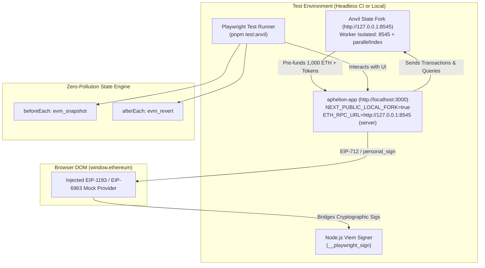
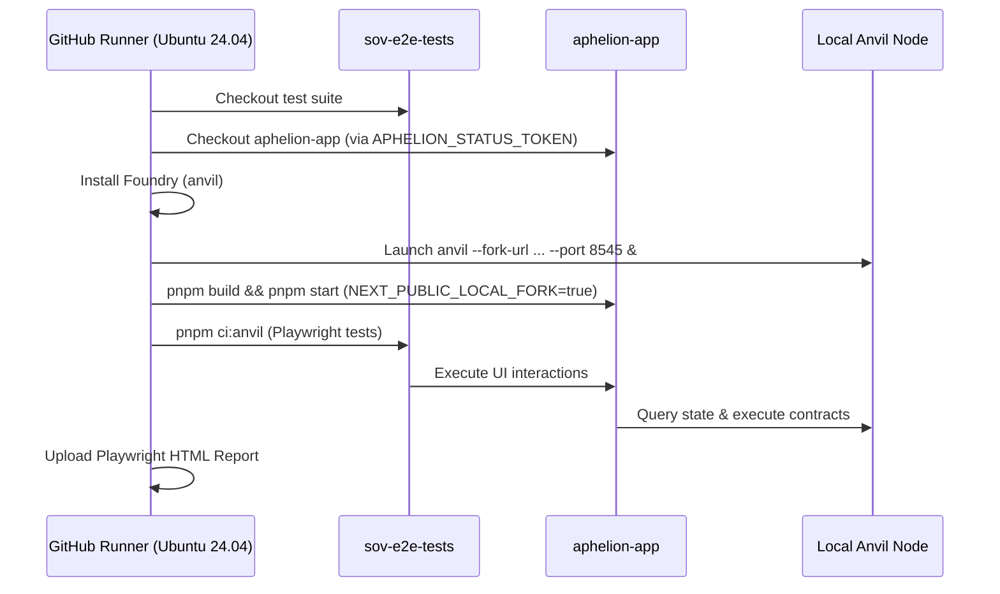

# 🏛️ Anvil Fork + Playwright Testing Guide (Local & CI)

This guide covers the **Deterministic Anvil Fork Testing Engine** in `sov-e2e-tests`. It enables fully automated, zero-gas, deterministic end-to-end testing of wallet workflows against live Ethereum, Base, and Arbitrum state.

---

## 📋 Table of Contents

- [Overview & Architecture](#-overview--architecture)
- [Why Staging Cannot Connect to Local Anvil](#-why-staging-cannot-connect-to-local-anvil)
- [Directory Structure & Project Organization](#-directory-structure--project-organization)
- [Local Development Workflow](#-local-development-workflow)
- [DeFi Product Workflows on Anvil: Multiply vs. Borrow vs. Earn](#-defi-product-workflows-on-anvil-multiply-vs-borrow-vs-earn)
- [Programmatic Anvil Fixture Deep Dive](#-programmatic-anvil-fixture-deep-dive)
- [GitHub Actions CI Workflow](#-github-actions-ci-workflow)
- [Environment Variables & CLI Commands](#-environment-variables--cli-commands)

---

## 🔍 Overview & Architecture

Testing Web3 applications against live public networks (or Sepolia testnets) suffers from:

1. Faucet rate limits and depleting test tokens.
2. Slow block confirmation times (12–15 seconds on L1).
3. Missing liquidity pools, oracles, and third-party protocol states on testnets.
4. Test state pollution: test A changes ledger state, causing subsequent tests to flake.

The Anvil Fork test harness solves this by combining **Foundry Anvil** with **Playwright + Mocked EIP-1193 Provider & Node.js Viem Cryptographic Signing**:



---

## 🏛️ The 90/10 Hybrid QA Pyramid: EIP-1193 vs. Synpress

To build an ultra-fast, zero-flakiness QA automation framework, the suite follows the **90/10 Hybrid QA Pyramid**:

| Evaluation Dimension    | Playwright + Mocked EIP-1193 (Anvil)                                                                                        | Synpress (MetaMask Extension)                                                                                        |
| :---------------------- | :-------------------------------------------------------------------------------------------------------------------------- | :------------------------------------------------------------------------------------------------------------------- |
| **Primary Scope**       | **90% of E2E Coverage:** PR-gating CI regression, local dev, full position lifecycles (Borrow, Multiply, Earn), edge cases. | **10% of E2E Coverage:** Staging wallet connector smoke testing, pre-flight gas verification, release sanity checks. |
| **Execution Speed**     | **Ultra-fast (~1–3s per scenario):** Zero extension boot, zero popup delays.                                                | **Slow (~25–40s per scenario):** Extension unpacking, keystore restore, window focus.                                |
| **Display Requirement** | **Native Headless Linux:** Runs in standard CI runners with zero display or Xvfb configuration.                             | **Heavy Display Requirement:** Requires Xvfb virtual frame buffer or headed Chromium.                                |
| **Cryptographic Proof** | **100% Authentic:** Signs messages and EIP-712 hashes using genuine private keys via Node.js Viem.                          | **Authentic:** Signs via extension keystore.                                                                         |
| **Parallel Execution**  | **Seamless:** 10–50 parallel workers locally or across matrix CI jobs with zero state collision.                            | **Constrained:** Extension state conflicts, popup focus contention, high memory overhead.                            |
| **Position Completion** | **Deterministic:** Calldata mined directly in local fork blocks; position creation completes end-to-end.                    | **Prone to Timeouts on Forks:** Nonce desyncs after reverts, slow gas estimation.                                    |
| **Gas Cost on Staging** | N/A (runs against local Anvil fork)                                                                                         | **$0.00:** Asserts `gas > 0` in pre-flight popup, then clicks **Reject**.                                            |

---

## ⚠️ Why Staging Cannot Connect to Local Anvil

The app reads chain data in two places:

| Where                                              | How it reaches the chain                                                                                  | Can tests redirect it to Anvil?                                                              |
| :------------------------------------------------- | :-------------------------------------------------------------------------------------------------------- | :------------------------------------------------------------------------------------------- |
| **Browser**                                        | Same-origin proxy `POST /api/rpc/<chainId>` (plus a WalletConnect RPC fallback in the wagmi transports)   | **Yes.** The fixture's `page.route` intercepts these and forwards them to the worker's Anvil |
| **Server** (API routes, SSR, vault/portfolio data) | Upstream RPC URLs from the app's server env (`ETH_RPC_URL`, `BASE_RPC_URL`, `PRODUCT_TABLE_*_RPC_URL`, …) | **No.** Only whoever runs the app controls its server env                                    |

Staging's server reads the live chain and can never see a local Anvil node. Against staging you would get a mixed state: balances read in the browser from Anvil, vault and position data from the live chain, and transactions sent to Anvil that staging's backend never sees. Snapshot/revert would only reset half the app.

> [!IMPORTANT]
> **Anvil fork tests MUST run against a local frontend (`http://localhost:3000`)** whose server RPC env points at Anvil. `pnpm app:fork` sets this up (`ETH_RPC_URL`, `PRODUCT_TABLE_ETH_RPC_URL`, … → `http://127.0.0.1:8545`).
>
> Known gap ([#72](https://github.com/Aphelion-Co/sov-e2e-tests/issues/72)): `app:fork`'s server reads its own Anvil on 8545, while each Playwright worker's browser traffic goes to that worker's Anvil (8600+). Tests that depend on server-side chain reads can see different state than the browser.

---

## 📁 Directory Structure & Project Organization

To keep staging E2E tests cleanly isolated from fork-driven tests, test suites are strictly partitioned:

| Suite / Project   | Test Directory           | Target URL                       | Description                                                             |
| :---------------- | :----------------------- | :------------------------------- | :---------------------------------------------------------------------- |
| **`no-wallet`**   | `tests/e2e/no-wallet/`   | `https://staging.supersmooth.fi` | Read-only UI, navigation, and marketing page tests                      |
| **`with-wallet`** | `tests/e2e/with-wallet/` | `https://staging.supersmooth.fi` | Live staging wallet flows (e.g. up to transaction rejection)            |
| **`anvil`**       | `tests/e2e/anvil/`       | `http://localhost:3000`          | Deterministic Anvil fork tests with pre-funded balances & state reverts |

---

## 💻 Local Development Workflow

### 1. Prerequisites

1. **Foundry (`anvil`)**: Install via `curl -L https://foundry.paradigm.xyz | bash && foundryup`
2. **Node.js & pnpm**: Node `>=20.9.0` (e.g. `nvm use 20.18.0` or `22.23.4`) and pnpm `>=9`.
3. **`aphelion-app` One-Time Setup**:
   In your `aphelion-app` checkout (`APHELION_APP_DIR`), ensure submodules and packages are built:
   ```bash
   git -c protocol.file.allow=always submodule update --init --recursive && \
   cp -n .env.example .env && \
   pnpm install && \
   pnpm build-packages
   ```

### 2. Start Anvil and `aphelion-app`

Run the orchestration launcher from `sov-e2e-tests`:

```bash
pnpm app:fork --chain=1
```

This automatically:

- Starts Anvil on `http://127.0.0.1:8545` forking Ethereum Mainnet with multi-RPC fallback (`rpc.mevblocker.io`, `eth.drpc.org`, etc.).
- **Seeds 1,000 ETH:** Pre-funds the test wallet (`0x44E361c3D9dcd703D535f9c2883a4E104AD2F4d5`) with 1,000 ETH via local EVM state (`anvil_setBalance`), ensuring instant, zero-network setup.
- **Pre-seeds Counterfactual Safe Bytecode:** Automatically seeds the user's predicted Safe address (`0xe6Cc2735F7E97274f9ee8A194DC93f2aC3CAADC9`) with empty code (`"0x"`) so dApp contract checks don't fail when checking if the Safe is deployed.
- Takes the initial baseline snapshot (`evm_snapshot`).
- Launches `aphelion-app` via `pnpm dev-app` on `http://localhost:3000`.

> [!NOTE]
> **Why ETH-Only Funding by Default?**
> Seeding ERC-20 tokens via whale account impersonation requires remote archive RPC queries for whale storage, balances, and contract bytecode, which frequently triggers public RPC rate limits and timeouts (`code: -32029`). Since UI and deposit flows use ETH collateral, ETH-only seeding runs in <2ms with zero external network dependencies.
>
> If you need to seed ERC-20 tokens (USDC, USDT, WBTC, cbBTC, WETH), pass the `--seed-tokens` flag or set `SEED_ALL_TOKENS=true`.

### 3. Run Anvil Playwright Tests

In a separate terminal:

```bash
# Run headless:
pnpm test:anvil

# Run headed (opens visible Chrome browser):
pnpm test:anvil:headed
```

### 4. Interactive Pausing during Headed Runs

To inspect the browser manually with the wallet connected and balance visible, simply insert:

```typescript
await app.pause();
```

into any test in [`tests/e2e/anvil/`](../tests/e2e/anvil/). Playwright will pause execution and leave the browser window open for interactive debugging.

---

## ⚖️ DeFi Product Workflows on Anvil: Multiply vs. Borrow vs. Earn

Understanding the architectural differences between product types is essential when developing and executing Anvil fork tests:

| Product Flow                            | Requires Swap Quote (`/api/swap-quote`)? |  Full On-Chain Tx on Anvil?   | Best Use Case on Anvil                                                              |
| :-------------------------------------- | :--------------------------------------: | :---------------------------: | :---------------------------------------------------------------------------------- |
| **Borrow** (`/products/borrow/...`)     |                ❌ **No**                 |   ✅ **Yes (100% Native)**    | Full lifecycle on-chain deposit, collateral pledge, and debt borrowing verification |
| **Earn** (`/products/earn/...`)         |                ❌ **No**                 |   ✅ **Yes (100% Native)**    | Full lifecycle yield vault deposit and share issuance                               |
| **Multiply** (`/products/multiply/...`) |         ✅ **Yes (0x / 1inch)**          | ⚠️ **Requires Real Calldata** | UI form testing, leverage slider validation, and quote calculation with Mock        |

### 1. Borrow & Earn: Zero-Dependency On-Chain Execution

Borrow and Earn products interact directly with lending pools (Aave V3, Morpho, Fluid, Compound) without executing decentralized exchange (DEX) swaps.

- **No Aggregator Dependencies:** These products never query `/api/swap-quote` or require third-party API credentials.
- **Instant Settlement:** With the test wallet pre-funded with 1,000 ETH and ERC-20 tokens, Borrow and Earn transactions execute and confirm cleanly on Anvil.
- **Recommended for On-Chain Tests:** To test genuine on-chain position opening, approval receipts, and Safe module interactions without mocking, use Borrow or Earn pools.

### 2. Multiply: Leverage, DEX Swaps, and Quote Mocking

Multiply positions amplify exposure by taking flash loans or borrowing debt, then swapping that borrowed debt into additional collateral via DEX aggregators (1inch or 0x).

#### The Local Development Bottleneck

In local development environments without commercial DEX API keys:

- 0x returns `503 (Swap provider 0x is not configured)` if `ZEROX_API_KEY` is not present.
- 1inch returns `503 (Swap provider 1inch temporarily unavailable (upstream 401))` if `ONEINCH_API_KEY` is missing or unauthorized.
- Without a valid quote, the frontend cannot calculate leverage ratios or output amounts, rendering the error:
  > _"We couldn't fetch a swap quote for this transaction. Nothing was submitted; we'll keep retrying automatically."_
  > and keeping the **"Open position"** button permanently disabled.

#### Deterministic Swap Mocking in Playwright

To enable comprehensive UI testing without third-party aggregator dependencies, [`src/fixtures/anvilFork.ts`](../src/fixtures/anvilFork.ts) intercepts `POST **/api/swap-quote**`:

- Intercepts incoming quote requests (`amountInNet`, `slippageBps`, `tokenIn`, `tokenOut`).
- Computes deterministic `amountOut` and `minAmountOut` values.
- Returns the on-chain whitelisted 1inch v6 router address (`0x111111125421cA6dc452d289314280a0f8842A65`).
- Satisfies the frontend preview calculations and removes the error banner. For **tiny deposits only** it also activates the **"Open position"** button (see [Deposit Amounts](#deposit-amounts-on-the-fork) below).

#### The On-Chain Execution Boundary for Multiply

While mock quotes completely unblock UI navigation, parameter validation, slider interactions, and preview cards, attempting to confirm the transaction on Anvil with mock calldata (`txData: '0x'`) will revert on-chain:

- The smart contract (`AggregatorSwapConnector`) executes `routerAddress.call(txData)` on Anvil.
- If `txData` is empty/mocked, no real AMM swap occurs against forked Uniswap pools.
- The contract's post-swap balance check (`balanceDelta >= minAmountOut`) triggers a revert.
- **Takeaway:** For Multiply, use Playwright route mocks to test the UI and transaction sizing up to the submit step. If complete on-chain confirmation is required for Multiply, a valid 1inch/0x API key with live AMM liquidity routing is required.

#### Deposit Amounts on the Fork

Fork wallets are pre-funded, so fork tests should use **realistic position sizes worth 10-100 ETH**. With-wallet tests on staging keep tiny amounts because they spend the real test wallet's funds. All fork amounts live in [`utils/constants/forkAmounts.ts`](../utils/constants/forkAmounts.ts) (`FORK_AMOUNTS`).

**Current limitation** ([#73](https://github.com/Aphelion-Co/sov-e2e-tests/issues/73)): `FORK_AMOUNTS.ethDeposit` is temporarily a tiny value (`0.001`):

- A realistic deposit (e.g. 25 ETH) makes the Multiply flow leverage up (about 2.5x by default), which needs a swap and adds the **"Choose Protection"** step.
- That step's button waits for a usable swap quote and transaction preview. With the mocked quote (1:1 rate, `txData: '0x'`) it stays **loading and disabled**, so the test can't continue.
- A tiny deposit skips that step and shows **"Open Position"** directly.
- `/api/fee-entitlement` also returns `500 Failed to sign fee entitlement` locally (fee-entitlement signing key not configured); not yet confirmed whether it blocks the flow.

**To switch to realistic amounts:**

1. Configure `aphelion-app`'s local env with swap provider keys (`ZEROX_API_KEY`, `ONEINCH_API_KEY`) and the fee-entitlement signing key, or have `pnpm app:fork` pass them through.
2. Remove the `/api/swap-quote` mock from `src/fixtures/anvilFork.ts`.
3. Set `FORK_AMOUNTS.ethDeposit` to a realistic value (e.g. `'25'`) and handle the "Choose Protection" step in the affected tests.

---

## 🔬 Programmatic Anvil Fixture Deep Dive

Tests in `tests/e2e/anvil/` import the test harness from [`src/fixtures/anvilFork.ts`](../src/fixtures/anvilFork.ts):

```typescript
import { test, expect } from '../../../src/fixtures/anvilFork';

test('sample fork test', async ({ app, anvilFork }) => {
  // Anvil is running on anvilFork.port (worker-isolated)
  // State resets automatically after the test finishes
  await app.vaultPage.openPage(url, { withBalance: true });
});
```

### Key Fixture Capabilities

1. **Worker Isolation:** Each Playwright parallel worker binds Anvil to `8545 + workerInfo.parallelIndex`, preventing port collisions.
2. **Zero-Pollution Reverts:**
   - Before test: Captures `evm_snapshot`.
   - After test: Calls `evm_revert(snapshotId)`. The next test starts with pristine ledger state in <50ms.
3. **RPC Resilience & Auto-Failover:** If an upstream RPC rate-limits or panics, the fixture automatically falls back through a curated list of archive endpoints (`rpc.mevblocker.io`, `eth.drpc.org`, `rpc.payload.de`, `eth.llamarpc.com`, `tenderly`) verifying storage read capability (`eth_getStorageAt`).
4. **EVM-Compliant Error Sanitization:** Transparently intercepts `Failed to get account for <address>` on `eth_getCode` for undeployed Safe proxies, returning standard `"0x"` bytecode and pre-seeding Anvil so dApp contract checks don't crash.
5. **Programmatic Controller Methods:**
   - `await anvilFork.setBalance(address, 500)`
   - `await anvilFork.fundToken({ tokenAddress, recipient, amount, whale })`
   - `await anvilFork.increaseTime(86400)` (time travel)
   - `await anvilFork.mine(10)`

---

## 🤖 GitHub Actions CI Workflow

Anvil fork tests run automatically in CI via [`.github/workflows/reusable-anvil-tests.yml`](../.github/workflows/reusable-anvil-tests.yml) and [`.github/workflows/anvil-tests.yml`](../.github/workflows/anvil-tests.yml).

### CI Architecture



### Nightly Scheduled Runs

The Anvil fork suite is also scheduled in [`.github/workflows/nightly.yml`](../.github/workflows/nightly.yml) under the `anvil-tests` job, ensuring daily regression protection against upstream smart contract and library changes.

The nightly job is **off by default**. CI has to build and start `aphelion-app` on the runner, which needs two repository secrets:

| Secret                  | Contents                                                                                                  |
| :---------------------- | :-------------------------------------------------------------------------------------------------------- |
| `APHELION_STATUS_TOKEN` | Fine-grained token for `Aphelion-Co/aphelion-app`: Contents read-only, Commit statuses read/write         |
| `APHELION_APP_ENV`      | The app's root `.env` for CI. Use a CI-only file with test/restricted keys, never a personal local `.env` |

Once both exist, enable the job by setting the repository variable `RUN_ANVIL_NIGHTLY` to `true` (**Settings → Secrets and variables → Actions → Variables**). Without them, a manual run of `anvil-tests.yml` fails fast at the "Verify fork app is reachable" step.

---

## ⚙️ Environment Variables & CLI Commands

### Key Environment Variables (`.env`)

| Variable              | Default                               | Purpose                                                     |
| :-------------------- | :------------------------------------ | :---------------------------------------------------------- |
| `FORK_BASE_URL`       | `http://localhost:3000`               | Target URL for Anvil Playwright project                     |
| `APHELION_APP_DIR`    | `../aphelion-app` (prompted if unset) | Path to local frontend repo for `pnpm app:fork`             |
| `ANVIL_BASE_PORT`     | `8600`                                | Base port for worker-isolated Anvil instances (not 8545)    |
| `ANVIL_FORK_CHAIN`    | `1`                                   | Default chain ID (1: Ethereum, 8453: Base, 42161: Arbitrum) |
| `TEST_WALLET_ADDRESS` | `0x44E361c3...F4d5`                   | Pre-funded test wallet address                              |

### Command Reference

| Command                      | Description                                                         |
| :--------------------------- | :------------------------------------------------------------------ |
| `pnpm app:fork`              | Interactive launcher for Anvil + `aphelion-app`                     |
| `pnpm test:anvil`            | Runs Playwright Anvil fork test suite (headless)                    |
| `pnpm test:anvil:headed`     | Runs Playwright Anvil fork test suite (headed browser)              |
| `pnpm test:anvil:regression` | Runs only `@regression` tagged Anvil fork tests                     |
| `pnpm ci:anvil`              | CI runner command (native headless Linux, zero display/xvfb needed) |
| `pnpm ci:anvil:regression`   | CI regression runner for `@regression` tagged fork tests            |
