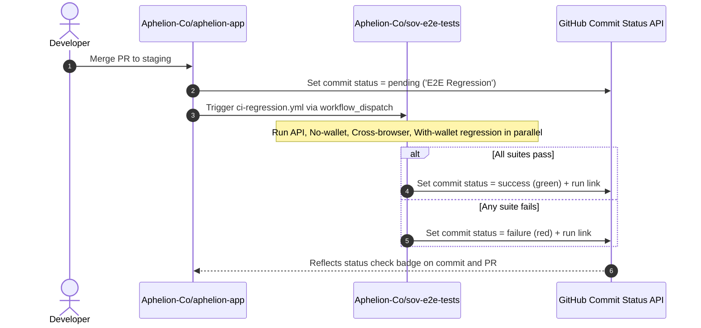

# Cross-Repository CI Regression: Architecture & Reference Guide

This document serves as the operational reference guide for the automated Continuous Integration (CI) cross-repository orchestration between **[aphelion-app](https://github.com/Aphelion-Co/aphelion-app)** and **[sov-e2e-tests](https://github.com/Aphelion-Co/sov-e2e-tests)**.

---

## 🎯 Architecture Summary

The integration operates asynchronously using the **GitHub Commit Statuses API**:

1. When changes merge into the `staging` branch of `aphelion-app`, an automated workflow dispatches the regression suite in `sov-e2e-tests` and marks the commit status as `pending`.
2. `sov-e2e-tests` executes the API, no-wallet, cross-browser, and with-wallet regression test suites in parallel.
3. Upon completion, a callback job in `sov-e2e-tests` evaluates the overall outcome and updates the commit status badge in `aphelion-app` to **success** (green) or **failure** (red), attaching a direct link to the test run and Playwright HTML reports.



---

## 🔑 1. Authentication & Secrets Configuration

Cross-repository authorization is handled via a shared GitHub token (Fine-Grained Personal Access Token or GitHub App):

- **Required Token Permissions**:
  - `Actions: Read and write` (to trigger workflows via `workflow_dispatch`).
  - `Statuses: Read and write` (to create and update commit status checks on `aphelion-app`).
- **Repository Secrets**:
  - `Aphelion-Co/aphelion-app`: Secret named `E2E_DISPATCH_TOKEN` containing the dispatch token.
  - `Aphelion-Co/sov-e2e-tests`: Secret named `APHELION_STATUS_TOKEN` containing the token to post commit statuses back to `aphelion-app`.

---

## 🚀 2. Trigger Workflow in `aphelion-app`

The trigger workflow is defined in `aphelion-app` at `.github/workflows/trigger-e2e-tests.yml`. It runs automatically when commits push to `staging`, creates the pending status check, and dispatches the runner workflow with run metadata.

**Workflow Configuration (`.github/workflows/trigger-e2e-tests.yml` in `aphelion-app`):**

```yaml
name: 'Trigger E2E Regression'

on:
  push:
    branches:
      - 'staging'

jobs:
  dispatch-e2e:
    name: 'Dispatch E2E Regression to sov-e2e-tests'
    runs-on: 'ubuntu-24.04'
    steps:
      - name: 'Set Pending Status Check on Commit'
        env:
          GH_TOKEN: '${{ secrets.E2E_DISPATCH_TOKEN }}'
        run: |
          gh api \
            --method POST \
            -H 'Accept: application/vnd.github+json' \
            /repos/${{ github.repository }}/statuses/${{ github.sha }} \
            -f state='pending' \
            -f target_url='${{ github.server_url }}/${{ github.repository }}/actions/runs/${{ github.run_id }}' \
            -f description='E2E regression tests queued in sov-e2e-tests...' \
            -f context='E2E Regression (sov-e2e-tests)'

      - name: 'Trigger sov-e2e-tests regression workflow'
        env:
          GH_TOKEN: '${{ secrets.E2E_DISPATCH_TOKEN }}'
        run: |
          gh workflow run ci-regression.yml \
            --repo Aphelion-Co/sov-e2e-tests \
            --ref main \
            -f run_id='${{ github.run_id }}' \
            -f repository='${{ github.repository }}' \
            -f commit_sha='${{ github.sha }}' \
            -f baseUrl='https://staging.supersmooth.fi/'
```

---

## 🧪 3. Execution & Callback Workflow in `sov-e2e-tests`

The test execution and callback workflow is located at `.github/workflows/ci-regression.yml` in `sov-e2e-tests`.

**Key Components:**

- **Inputs**: Receives `run_id`, `repository`, `commit_sha`, and `baseUrl`.
- **Parallel Test Execution**: Runs `api-tests`, `no-wallet-tests`, `cross-browser-tests`, and `with-wallet-tests` concurrently using the reusable workflow templates.
- **Callback Job (`report-status`)**: Runs with `if: always()` after all test jobs complete, determines overall success or failure, updates the commit status badge in `aphelion-app`, and publishes a summary to `$GITHUB_STEP_SUMMARY`.

**Workflow Configuration (`.github/workflows/ci-regression.yml` in `sov-e2e-tests`):**

```yaml
name: 'Regression Run'

on:
  workflow_dispatch:
    inputs:
      run_id:
        description: 'Run ID from repository that is triggering this workflow.'
        type: 'string'
        required: true
      repository:
        description: 'Name of the repository that is triggering this workflow (e.g. Aphelion-Co/aphelion-app).'
        type: 'string'
        required: true
      commit_sha:
        description: 'Commit SHA from triggering repository to report status to.'
        type: 'string'
        required: true
      baseUrl:
        description: 'Base URL for testing'
        type: 'string'
        default: 'https://staging.supersmooth.fi/'

permissions:
  contents: read
  statuses: write

jobs:
  api-tests:
    uses: './.github/workflows/reusable-api-tests.yml'
    with:
      baseUrl: '${{ inputs.baseUrl }}'
      script: 'test:api:regression'

  no-wallet-tests:
    uses: './.github/workflows/reusable-no-wallet.yml'
    with:
      baseUrl: '${{ inputs.baseUrl }}'
      script: 'ci:no-wallet-regression'

  cross-browser-tests:
    uses: './.github/workflows/reusable-no-wallet-cross-browser.yml'
    with:
      baseUrl: '${{ inputs.baseUrl }}'

  with-wallet-tests:
    uses: './.github/workflows/reusable-with-wallet.yml'
    secrets: inherit
    with:
      baseUrl: '${{ inputs.baseUrl }}'
      script: 'ci:with-wallet-regression'

  report-status:
    name: 'Report Status to Calling Repository'
    runs-on: 'ubuntu-24.04'
    needs: [api-tests, no-wallet-tests, cross-browser-tests, with-wallet-tests]
    if: always()
    steps:
      - name: 'Evaluate test results'
        id: test-result
        run: |
          API='${{ needs.api-tests.result }}'
          NO_WALLET='${{ needs.no-wallet-tests.result }}'
          CROSS_BROWSER='${{ needs.cross-browser-tests.result }}'
          WITH_WALLET='${{ needs.with-wallet-tests.result }}'

          if [ $API = 'success' ] && [ $NO_WALLET = 'success' ] && [ $CROSS_BROWSER = 'success' ] && [ $WITH_WALLET = 'success' ]; then
            echo 'state=success' >> $GITHUB_OUTPUT
            echo 'description=All E2E, cross-browser, and API regression tests passed successfully' >> $GITHUB_OUTPUT
          else
            echo 'state=failure' >> $GITHUB_OUTPUT
            echo 'description=E2E and/or API regression failed (API: '$API', No-Wallet: '$NO_WALLET', Cross-Browser: '$CROSS_BROWSER', With-Wallet: '$WITH_WALLET')' >> $GITHUB_OUTPUT
          fi

      - name: 'Send status back to calling repository'
        env:
          GH_TOKEN: '${{ secrets.APHELION_STATUS_TOKEN || secrets.GITHUB_TOKEN }}'
        run: |
          gh api \
            --method POST \
            -H 'Accept: application/vnd.github+json' \
            /repos/${{ inputs.repository }}/statuses/${{ inputs.commit_sha }} \
            -f state='${{ steps.test-result.outputs.state }}' \
            -f target_url='${{ github.server_url }}/${{ github.repository }}/actions/runs/${{ github.run_id }}' \
            -f description='${{ steps.test-result.outputs.description }}' \
            -f context='E2E Regression (sov-e2e-tests)'

      - name: 'Publish workflow summary'
        run: |
          echo '### E2E Regression Summary' >> $GITHUB_STEP_SUMMARY
          echo '- **Calling Repository**: [`${{ inputs.repository }}`](https://github.com/${{ inputs.repository }})' >> $GITHUB_STEP_SUMMARY
          echo '- **Triggering Run**: [Run #${{ inputs.run_id }}](https://github.com/${{ inputs.repository }}/actions/runs/${{ inputs.run_id }})' >> $GITHUB_STEP_SUMMARY
          echo '- **Target Commit**: `${{ inputs.commit_sha }}`' >> $GITHUB_STEP_SUMMARY
          echo '- **Overall Status**: **${{ steps.test-result.outputs.state }}**' >> $GITHUB_STEP_SUMMARY
```

---

## ⚙️ 4. Script & Reporting Parity Reference

The regression scripts and report directory paths in `package.json` are aligned with the reusable workflow definitions:

| Test Suite                 | `package.json` Script                      | Report Directory Path                        | Reusable Workflow Artifact                                         |
| :------------------------- | :----------------------------------------- | :------------------------------------------- | :----------------------------------------------------------------- |
| **API Regression**         | `test:api:regression`                      | `playwright-reports/api-tests`               | `reusable-api-tests.yml` (`api-tests`)                             |
| **No-wallet Regression**   | `ci:no-wallet-regression`                  | `playwright-reports/no-wallet`               | `reusable-no-wallet.yml` (`no-wallet`)                             |
| **Cross-browser Matrix**   | `pnpm playwright test --project=<project>` | `playwright-reports/cross-browser-<project>` | `reusable-no-wallet-cross-browser.yml` (`cross-browser-<project>`) |
| **With-wallet Regression** | `ci:with-wallet-regression`                | `playwright-reports/with-wallet`             | `reusable-with-wallet.yml` (`with-wallet`)                         |

---

## 🛠️ 5. Maintenance & Troubleshooting Guide

### How to Add a New Test to Regression

- Tag any test describe block or test case with `@regression` (e.g. `test.describe('Feature @regression', () => { ... })`).
- The test will automatically be included in subsequent runs of `ci-regression.yml`.

### How to Update or Rotate Tokens

- If cross-repo permissions expire, generate a new fine-grained GitHub PAT with `Actions: Read and write` and `Statuses: Read and write`.
- Update `E2E_DISPATCH_TOKEN` in `aphelion-app` and `APHELION_STATUS_TOKEN` in `sov-e2e-tests`.

### Debugging Status Callback Failures

- If the status badge does not appear in `aphelion-app`:
  1. Inspect the `report-status` job logs in `sov-e2e-tests`.
  2. Verify that `APHELION_STATUS_TOKEN` is populated in repository secrets.
  3. Ensure `inputs.commit_sha` matches an existing commit SHA in `aphelion-app`.

---

## 🔄 6. Alternative Reference: Synchronous Wait Pattern

In scenarios where a workflow in `aphelion-app` must pause execution and block until `sov-e2e-tests` finishes, the `benc-uk/workflow-dispatch` action can be used:

```yaml
# Inside aphelion-app workflow:
- name: 'Trigger and wait for sov-e2e-tests'
  uses: 'benc-uk/workflow-dispatch@v1'
  with:
    workflow: 'ci-regression.yml'
    repo: 'Aphelion-Co/sov-e2e-tests'
    token: '${{ secrets.E2E_DISPATCH_TOKEN }}'
    ref: 'main'
    wait-for-completion: true
    inputs: '{ "run_id": "${{ github.run_id }}", "repository": "${{ github.repository }}", "commit_sha": "${{ github.sha }}" }'
```
