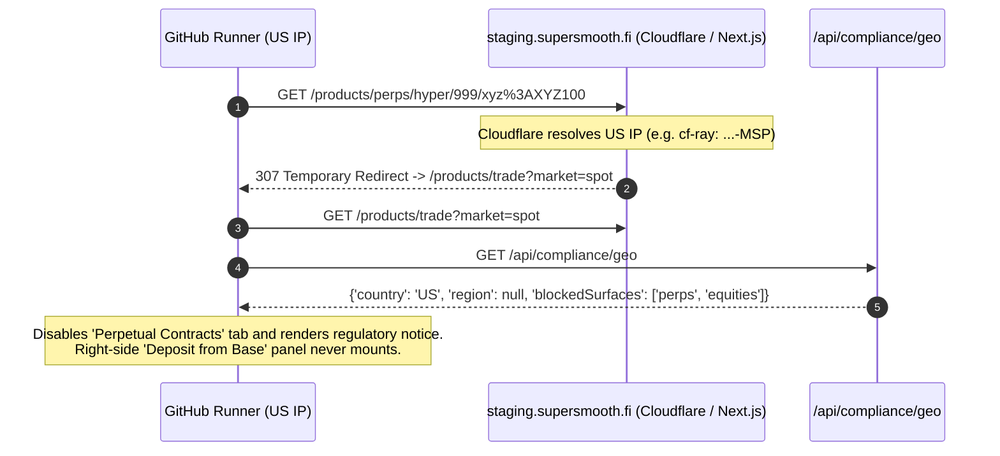

# CI & GitHub Runs Reference Guide

This document serves as a reference for known environment differences, regional restrictions, and troubleshooting notes when executing Playwright E2E and API suites in **GitHub Actions** (Nightly and CI runs) compared to local runs.

---

## 🌍 1. US Geo-Blocking on GitHub-Hosted Runners (`perps` & `equities`)

### Affected Test(s)

- **File**: `tests/e2e/with-wallet/openPosition.spec.ts`
- **Describe Block**: `'Open position - Trade (Perpetual Contracts) on HyperEVM (Deposit from Base)'`
- **Test Case**: `'It should open XYZ100/USDC perp - until rejecting first transaction'`

### Symptom

The test consistently passes when executed locally from an allowed region (e.g. Europe), but fails on every retry in GitHub Actions (`nightly.yml` / `with-wallet-tests.yml`) with a `10000ms` timeout waiting for the `'Deposit from Base'` button:

```text
Error: Timed out 10000ms waiting for expect(locator).toBeVisible()

Locator: getByRole('button', { name: 'Deposit from Base' })
Expected: visible
Received: <element(s) not found>

  at ../src/pages/rightSidePanel/configurePosition.ts:19
```

---

### Root Cause

Standard GitHub-hosted runners (`ubuntu-24.04` / `ubuntu-latest`) operate inside **US Azure data centers**. On `staging.supersmooth.fi`, **Perpetual Contracts (`perps`) and Equities (`equities`) are geo-blocked for US IP addresses** due to regulatory compliance.



1. **Server-Side `307` Redirect**:
   When `app.perpAndSpotPage.openPage('/products/perps/hyper/999/xyz%3AXYZ100')` navigates to the Perpetual Contracts URL from a US runner IP, Cloudflare tags the request with `cf-ipcountry: US` (e.g. `cf-ray: ...-MSP` in Minneapolis), and the Next.js server immediately redirects:
   ```text
   GET https://staging.supersmooth.fi/products/perps/hyper/999/xyz%3AXYZ100 -> 307 Temporary Redirect
   location: /products/trade?market=spot
   ```
2. **Client-Side Geo-Compliance Check (`/api/compliance/geo`)**:
   Once redirected to `/products/trade?market=spot`, the frontend fetches `GET https://staging.supersmooth.fi/api/compliance/geo`, receiving:
   ```js
   {
     'country': 'US',
     'region': null,
     'blockedSurfaces': ['perps', 'equities']
   }
   ```
3. **Resulting UI State**:
   - The user lands on the **Spot Exchange** overview page (`/products/trade?market=spot`) instead of the `XYZ100/USDC` perpetual position page.
   - The `'Perpetual Contracts'` tab is disabled and displays the regulatory banner:
     > `'Perpetual contracts is not available in your region for regulatory reasons.'`
   - Because `'spot'` is not in `blockedSurfaces`, the Spot Exchange test in the same spec (`'It should open uBTC/USDC trade - until rejecting first transaction'` at `/products/spot/hyper/999/ubtc-usdc`) is unaffected and passes in GitHub Actions.

> [!NOTE]
> Even if a custom `cf-ipcountry` header is sent from Playwright in CI, Cloudflare overwrites incoming `cf-ipcountry` headers at the edge with the actual client IP country before forwarding the request to the origin server. (For testing `/api/compliance/geo` header logic directly without Cloudflare, see [`tests/api/complianceGeoFakeLocation.spec.ts`](../tests/api/complianceGeoFakeLocation.spec.ts) and [`scripts/mock-compliance-server.js`](../scripts/mock-compliance-server.js).)

---

### Current CI Workaround

In [`tests/e2e/with-wallet/openPosition.spec.ts`](../tests/e2e/with-wallet/openPosition.spec.ts), the suite is statically skipped when `process.env.CI` is truthy by placing `test.skip()` at the top of the `test.describe` block:

```ts
test.describe('Open position - Trade (Perpetual Contracts) on HyperEVM (Deposit from Base)', () => {
  test.skip(
    !!process.env.CI,
    'Skipped in CI: Perpetual contracts are geo-blocked on US GitHub Actions runners',
  );
```

Because `test.skip(condition, description)` is declared at the `test.describe` level (outside the `test(...)` body), Playwright evaluates it statically at test discovery time (`0ms` execution time) and **does not initialize the Synpress / MetaMask fixtures** (`_contextPath`, `context`, `metamask`, `app`) or `beforeEach` hooks, while still recording the test as **Skipped** with the reason in the HTML report.

*(In [`eslint.config.js`](../eslint.config.js), `'playwright/no-skipped-test': ['warn', { allowConditional: true }]` is configured to permit conditional `test.skip(condition)` calls while still flagging unconditional `.skip()` usage.)*

---

### Long-Term Remediation Options

> [!IMPORTANT]
> Intercepting `/api/compliance/geo` on the client side via Playwright's `page.route()` is **not sufficient on its own**, because the `307 Temporary Redirect` on `/products/perps/...` occurs server-side (in Next.js middleware/SSR) before the page loads in the browser.

| Option | Approach | Implementation Summary |
| :--- | :--- | :--- |
| **1. E2E Geo-Bypass Header / Cookie (Recommended)** | Server + Client bypass on `staging` | Update `staging.supersmooth.fi` middleware and `/api/compliance/geo` to check a dedicated E2E header or cookie (e.g. `x-e2e-country-override: 'ES'` or a shared CI bypass secret) before reading `cf-ipcountry`. Inject that header/cookie in Playwright's context fixture. |
| **2. Disable Geo-Blocking on `staging`** | Environment variable on `staging` | Disable `blockedSurfaces` enforcement in the `staging` deployment environment while keeping it enforced on production (`supersmooth.fi`). |
| **3. Non-US Proxy or Runner in CI** | Network / Runner routing | Configure Playwright in CI to route traffic through an EU proxy (`use: { proxy: { server: process.env.CI_PROXY_URL } }`), add a VPN step in the GitHub Actions workflow, or execute on a self-hosted runner in a non-restricted region. |
