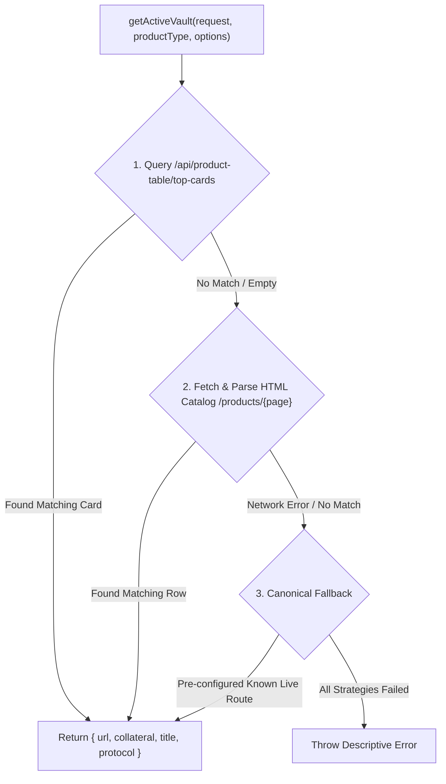

# 🛡️ Dynamic Vault Selection Guide

This guide explains the architecture, motivation, and usage of the dynamic vault selection helper (`getActiveVault`) used across no-wallet and with-wallet E2E tests.

---

## 📋 Table of Contents

- [Motivation & Problem Statement](#motivation--problem-statement)
- [How `getActiveVault` Works](#how-getactivevault-works)
- [API Reference](#api-reference)
- [Usage in Tests](#usage-in-tests)
  - [1. No-Wallet Tests (Unconstrained Discovery)](#1-no-wallet-tests-unconstrained-discovery)
  - [2. With-Wallet Tests (Balance-Constrained Discovery)](#2-with-wallet-tests-balance-constrained-discovery)
  - [3. Terms of Service Verification](#3-terms-of-service-verification)
- [Resilience & Fallback Strategy](#resilience--fallback-strategy)
- [Best Practices](#best-practices)

---

## 🔍 Motivation & Problem Statement

In Web3 dApps, financial markets and liquidity pools change frequently:

- **Market Deprecations & Delistings:** Protocols upgrade contracts or phase out older versions (e.g., Aave V3 markets removed on staging). Hardcoded URLs such as `/products/multiply/aaveV3/8453/...` become dead links returning 404 "Page not found".
- **Liquidity Migration:** Vaults might pause deposits, reach capacity, or migrate to new risk managers.
- **Protocol Routing Nuances:** Some protocols only support certain product types in the UI (e.g. Yield Loops in the UI are supported by Spark and Fluid, whereas Morpho markets may not expose yield loop routes).

Hardcoding contract addresses directly in test files leads to brittle tests that break whenever upstream environments evolve. **Dynamic Vault Selection** guarantees that tests query the live dApp state and select active, deposit-ready vaults at runtime.

---

## ⚙️ How `getActiveVault` Works

Located in [`utils/getActiveVault.ts`](../utils/getActiveVault.ts), the helper executes a tiered resolution strategy:



1. **Top Cards API (Fast Path):**
   Calls `/api/product-table/top-cards?productType=...` with optional query parameters (`filterId`, `network`, `protocols`). If a matching active card is found, it extracts the direct vault `url` and `collateral` symbol.
2. **HTML Catalog Fallback:**
   When specific filter criteria (e.g. Multiply on Base with ETH collateral) are not featured in the top 4 highlighted cards, the helper fetches the server-rendered product catalog page (`/products/${catalogPage}`) and extracts the first matching vault table row.
3. **Canonical Route Fallback:**
   If API or network errors occur during discovery, the helper falls back to known resilient canonical routes for supported networks (e.g., Base).

---

## 📖 API Reference

```typescript
import { getActiveVault } from '../../../utils/getActiveVault';

const { url, collateral, title, protocol } = await getActiveVault(request, productType, options);
```

### Parameters

| Parameter            | Type                                                             | Required | Description                                                     |
| :------------------- | :--------------------------------------------------------------- | :------- | :-------------------------------------------------------------- |
| `request`            | `APIRequestContext`                                              | Yes      | Playwright's `request` fixture or `app.page.request`            |
| `productType`        | `'multiply' \| 'borrow' \| 'earn' \| 'yieldLoop'`                | Yes      | The product family to query                                     |
| `options.network`    | `'Base' \| 'Ethereum' \| 'Arbitrum' \| 'HyperEVM' \| 'Optimism'` | No       | Target network filter                                           |
| `options.collateral` | `string`                                                         | No       | Required deposit token (e.g. `'ETH'`, `'USDC'`, `'cbETH'`)      |
| `options.protocols`  | `string`                                                         | No       | Comma-separated protocol IDs (e.g. `'morpho'`, `'spark,fluid'`) |
| `options.filterId`   | `string`                                                         | No       | Sorting criterion (`'most-liquidity'`, `'highest-current-apy'`) |

### Return Value

Returns a Promise resolving to `ActiveVaultResult`:

```typescript
interface ActiveVaultResult {
  url: string; // Relative path, e.g. '/products/borrow/morpho/8453/0x8793...'
  collateral: Token; // Deposit token symbol, e.g. 'ETH', 'USDC'
  title: string; // Display title, e.g. 'WETH/USDC'
  protocol: string; // Protocol identifier, e.g. 'morpho'
}
```

---

## 🧪 Usage in Tests

### 1. No-Wallet Tests (Unconstrained Discovery)

In no-wallet tests ([`tests/e2e/no-wallet/vaultPages.spec.ts`](../tests/e2e/no-wallet/vaultPages.spec.ts)), any active vault is sufficient to test page loads and wallet connection prompts:

```typescript
import { test } from '../../../src/fixtures';
import { getActiveVault } from '../../../utils/getActiveVault';

test('it should request to connect wallet when trying to open a Multiply position', async ({
  app,
  request,
}) => {
  const { url, collateral } = await getActiveVault(request, 'multiply', {
    filterId: 'most-liquidity',
  });

  await app.vaultPage.openPage(url, { collateral });
  await app.vaultPage.rightSidePanel.configurePosition.connectWallet();
  await app.modals.connectWallet.shouldBeVisible();
});
```

### 2. With-Wallet Tests (Balance-Constrained Discovery)

In with-wallet tests ([`tests/e2e/with-wallet/openPosition.spec.ts`](../tests/e2e/with-wallet/openPosition.spec.ts)), the test wallet holds specific token balances on a specific network (e.g. Base):

> [!IMPORTANT]
> The test wallet on Base has funded balances in **ETH**, **wstETH**, **cbETH**, and **USDC**. Passing these collateral requirements into `getActiveVault` ensures tests only navigate to vaults the wallet can actually deposit into.

```typescript
// Open Multiply position with ETH collateral on Base:
const { url, collateral } = await getActiveVault(app.page.request, 'multiply', {
  network: 'Base',
  collateral: 'ETH',
});
await app.vaultPage.openPage(url, { collateral });

// Open Automated Strategy position with USDC on Base:
const { url, collateral } = await getActiveVault(app.page.request, 'earn', {
  network: 'Base',
  protocols: 'morpho',
  collateral: 'USDC',
});
await app.vaultPage.openPage(url, { collateral });
```

### 3. Terms of Service Verification

[`utils/verifyTermsAndAcceptIfNeeded.ts`](../utils/verifyTermsAndAcceptIfNeeded.ts) automatically resolves a live position page dynamically when checking or accepting Terms of Service signatures:

```typescript
const active = await getActiveVault(apiRequest, 'multiply', {
  network: 'Base',
  collateral: 'ETH',
});
await app.vaultPage.openPage(active.url, { collateral: active.collateral });
```

---

## 🛡️ Resilience & Fallback Strategy

1. **Protocol Sanitization:** For Yield Loops, if no specific protocol is supplied, `getActiveVault` defaults to `'spark,fluid'` because Morpho does not expose yield loop routes in the UI.
2. **Token Normalization:** Handles token aliases automatically (e.g. matching `'WETH'` vault collateral when requesting `'ETH'`).
3. **Graceful Error Handling:** If all endpoints and scraping fallbacks are unreachable, clear diagnostic errors are surfaced with query parameters, HTTP status codes, and checked routes.

---

## 💡 Best Practices

1. **Avoid Hardcoded Position URLs:** Never hardcode contract hashes in `.spec.ts` files. Use `getActiveVault` instead.
2. **Match Test Wallet Balances:** For with-wallet tests, always pass `network: 'Base'` and `collateral: <token>` to match wallet funds.
3. **Use Protocol Filters When Applicable:** If testing protocol-specific integrations (such as Gauntlet or Morpho vaults), specify the `protocols` option to avoid non-target vaults.
