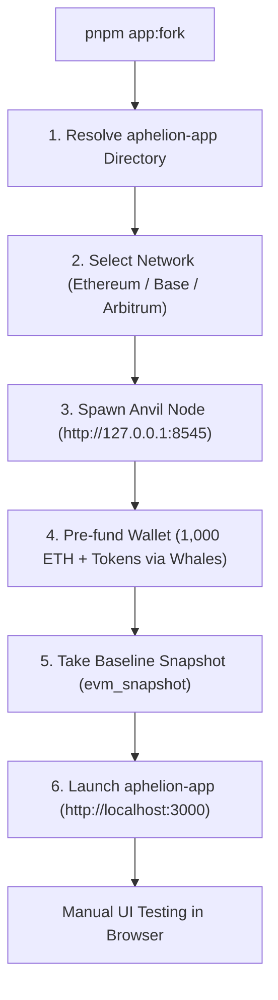

# 🍴 Local dApp Runner with Anvil State Fork

This guide explains how to run the **`aphelion-app`** frontend locally against a live **Anvil state fork** using the orchestration runner in this repository (`pnpm app:fork`).

---

## 📋 Table of Contents

- [Overview](#overview)
- [Prerequisites](#prerequisites)
- [Quick Start](#quick-start)
- [Supported Networks & RPC Failover](#supported-networks--rpc-failover)
- [Automated Token Pre-Funding](#automated-token-pre-funding)
- [Custom Token Funding](#custom-token-funding)
- [MetaMask & Wallet Configuration](#metamask--wallet-configuration)
- [Interactive Console Controls (Warp & Reset)](#interactive-console-controls-warp--reset)
- [Future Integration: Playwright E2E Automation](#future-integration-playwright-e2e-automation)

---

## 🔍 Overview

Manual testing against live public testnets (e.g. Sepolia) often suffers from faucet limits, slow block confirmations, and missing third-party protocol liquidity (Uniswap pools, Aave markets, oracles).

The local fork runner solves this by creating a **local Anvil fork** of live mainnet state, pre-funding your test wallet with 1,000 ETH and major protocol tokens (USDC, USDT, WBTC, cbBTC, WETH), and automatically launching `aphelion-app` configured to query the local node.



---

## 🛠️ Prerequisites

1. **Foundry (`anvil`)**:
   Anvil is the high-performance local Ethereum node from Foundry. Install it via:

   ```bash
   curl -L https://foundry.paradigm.xyz | bash
   foundryup
   ```

   Verify installation:

   ```bash
   anvil --version
   ```

2. **Local `aphelion-app` Repository**:
   Have the frontend repository cloned locally on your machine.

---

## 🚀 Quick Start

Run the interactive launcher:

```bash
pnpm app:fork
```

The script guides you through:

1. Entering your `aphelion-app` directory (suggests `../aphelion-app` by default).
2. Choosing the network to fork (**Ethereum Mainnet**, **Base**, or **Arbitrum One**).
3. Optional block height pinning (press `Enter` to use the latest live block).
4. Optional custom token funding.

Once initialized, Anvil runs on `http://127.0.0.1:8545` and `aphelion-app` opens on `http://localhost:3000`.

### CLI Options (Non-Interactive)

You can bypass interactive prompts by passing flags or setting `.env` variables:

```bash
# Fork Ethereum Mainnet (default):
pnpm app:fork --app-dir=../aphelion-app

# Fork Base network with a custom RPC:
pnpm app:fork --chain=8453 --fork-url=https://mainnet.base.org

# Pin a specific block height:
pnpm app:fork --chain=1 --block=21000000

# Pre-fund extra custom tokens (format: "0xToken:Amount" or "0xToken:Amount:WhaleAddress"):
pnpm app:fork --tokens="0xTokenAddress:5000"
pnpm app:fork --tokens="0xTokenAddress:5000:0xWhaleAddress"
```

---

## 🌐 Supported Networks & RPC Failover

If no private Alchemy or Infura key is configured, the script automatically tests and selects from a curated list of reliable public archive RPCs:

| Network                          | Chain ID | Primary Archive RPC            | Fallbacks                                              |
| :------------------------------- | :------- | :----------------------------- | :----------------------------------------------------- |
| **Ethereum Mainnet** _(Default)_ | `1`      | `https://cloudflare-eth.com`   | `https://eth.llamarpc.com`, `https://rpc.ankr.com/eth` |
| **Base**                         | `8453`   | `https://mainnet.base.org`     | `https://base.llamarpc.com`, `https://1rpc.io/base`    |
| **Arbitrum One**                 | `42161`  | `https://arb1.arbitrum.io/rpc` | `https://arbitrum.llamarpc.com`, `https://1rpc.io/arb` |

---

## 💰 Automated Token Pre-Funding

Once the Anvil node is healthy, the script automatically seeds `TEST_WALLET_ADDRESS` (defined in `.env`):

1. **Native ETH:** Funds **1,000 ETH** via `anvil_setBalance`.
2. **ERC-20 Tokens:** Uses Anvil account impersonation (`anvil_impersonateAccount`) to transfer live tokens directly from major exchange/protocol whale addresses:

| Network                    | Seeded Tokens & Balances                                     |
| :------------------------- | :----------------------------------------------------------- |
| **Ethereum (`1`)**         | `50,000 USDC`, `50,000 USDT`, `5 WBTC`, `5 cbBTC`, `50 WETH` |
| **Base (`8453`)**          | `50,000 USDC`, `5 cbBTC`, `50 WETH`                          |
| **Arbitrum One (`42161`)** | `50,000 USDC`, `50,000 USDT`, `5 WBTC`, `50 WETH`            |

---

## 🪙 Custom Token Funding

Need a specific governance, LP, or test token not included in the defaults?

- During startup, respond `y` to:
  ```text
  Do you need funds in other token(s)? (y/N): y
  ```
- Enter the contract address (e.g. `0x...`, `0xToken:Amount`, or `0xToken:Amount:WhaleAddress`).
- The script automatically queries `decimals()` and `symbol()` via `eth_call` on the fork, transfers the requested amount to your wallet, and displays confirmation. If a custom whale address is not provided, it automatically impersonates a high-balance liquidity holder on the selected network.

---

## 🦊 MetaMask & Wallet Configuration

To interact with the local fork in your browser, add a custom RPC network in MetaMask or Rabby:

| Setting             | Value                                                 |
| :------------------ | :---------------------------------------------------- |
| **Network Name**    | `Anvil Fork (Local)`                                  |
| **New RPC URL**     | `http://127.0.0.1:8545`                               |
| **Chain ID**        | `1` (or `8453` / `42161` depending on chosen network) |
| **Currency Symbol** | `ETH`                                                 |

Import the private key corresponding to `TEST_WALLET_ADDRESS` from `.env` to access the pre-funded balances.

---

## ⚡ Interactive Console Controls (Warp & Reset)

While the fork is running, you can type commands directly into the terminal console:

### 1. Time Travel (`warp <duration>`)

Advance the blockchain clock to test yield accrual, lockups, and reward vesting:

```text
warp 1d     # Advance clock by 1 day and mine a new block
warp 7d     # Advance clock by 7 days
warp 3600   # Advance clock by 3,600 seconds (1 hour)
```

### 2. Instant State Reset (`reset`)

Reverts the entire blockchain back to the initial funded state baseline snapshot (`evm_revert`), undoing any trades, approvals, or vault deposits without restarting the fork:

```text
reset
```

### 3. Graceful Exit (`exit` / `quit` / `Ctrl+C`)

Shuts down both the Anvil node and the Next.js dev server cleanly, ensuring ports `8545` and `3000` are released.

---

## 🤖 Future Integration: Playwright E2E Automation

This fork infrastructure can be integrated directly into [`playwright.config.ts`](../playwright.config.ts) under Playwright's `webServer` or a global setup fixture. This enables running automated tests (`pnpm test:with-wallet`) with zero gas fees, instant mining, and completely deterministic blockchain state.
