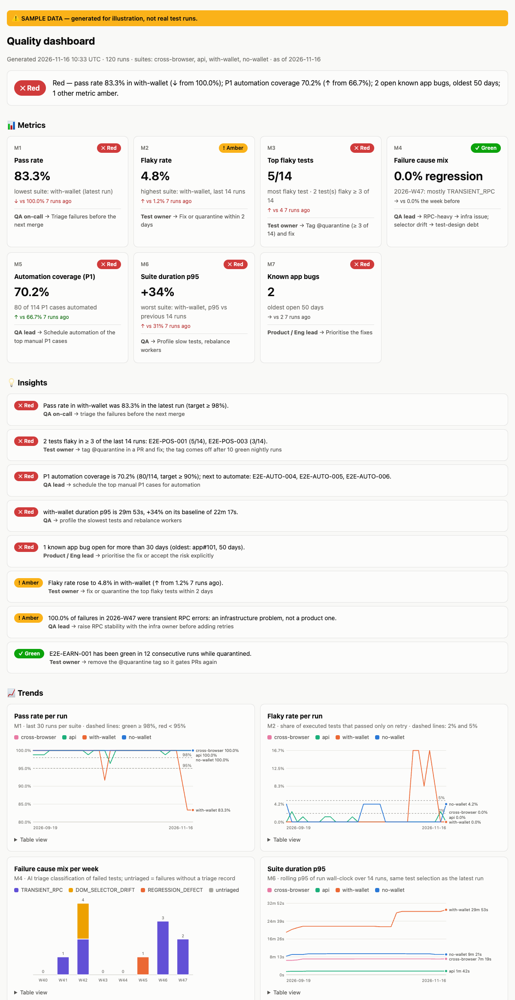
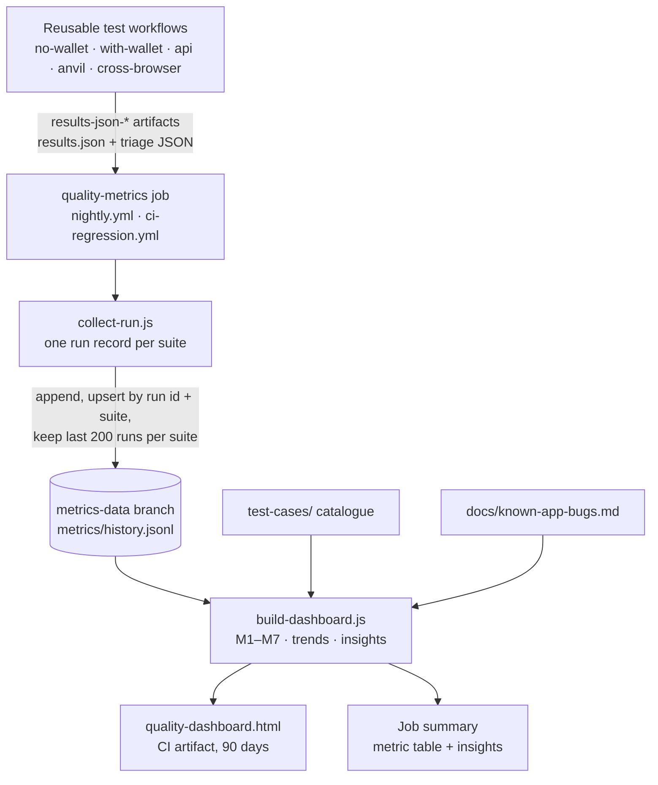

# 📈 Quality Metrics & Health Dashboard

The **quality metrics model** defines which numbers describe product and test-suite health, keeps
their history from every CI run, and turns them into a decision: each metric has a **threshold**,
an **owner** and an **action**. A number nobody acts on is not tracked.



> The screenshot uses **sample data** (`pnpm metrics:dashboard --sample`), clearly labelled as such
> on the page. Real dashboards are built by CI from the `metrics-data` history branch.

---

## 🎯 Key Capabilities & Value

- **🚦 One health status for management:** a Green / Amber / Red badge (worst of M1, M2, M5-P1 and M7) and one sentence, e.g. _"Red — flaky rate 7.1% in with-wallet (↑ from 1.2%), driven by 2 repeatedly flaky tests"_.
- **👤 Every metric has an owner and an action:** the dashboard prints who acts and what they do, next to the number.
- **📉 Trends, not snapshots:** each metric is compared with its value 7 runs ago, so a slow slide is visible **before** it reaches users.
- **🧪 Flakiness is measured, not felt:** a rolling 14-run flaky rate per suite, the tests behind it, and a quarantine policy with an entry **and** an exit criterion.
- **⚖️ Risk-weighted coverage:** automation coverage is reported per priority; P1 drives the status, not a raw overall percentage.
- **🤖 AI triage feeds the model:** the failure cause mix (RPC / selector drift / regression) says whether to invest in infrastructure stability or in test design.
- **💡 Rule-based insights:** 3–5 generated sentences, each with an owner and an action. Plain rules: explainable, testable, no AI tokens.
- **📦 Offline by design:** one static HTML file with inline SVG charts, no scripts or network requests. It opens straight from the CI artifact zip and respects light / dark mode.

---

## 📐 The Metrics Model

Thresholds, owners and actions live in [`scripts/metrics/model.js`](../scripts/metrics/model.js)
(`THRESHOLDS`, `METRICS`) and are unit tested at their boundaries. Boundaries are inclusive on the
green side (e.g. exactly 98.0% pass rate is green).

| #      | Metric                                  | Definition & formula                                                                                                                                           | Data source                                                                 | 🟢 Green / 🟡 Amber / 🔴 Red                          | Owner → action when red                                                                              |
| :----- | :-------------------------------------- | :------------------------------------------------------------------------------------------------------------------------------------------------------------- | :-------------------------------------------------------------------------- | :---------------------------------------------------- | :--------------------------------------------------------------------------------------------------- |
| **M1** | **Pass rate** (per suite, latest run)   | (passed + flaky + known-bug expected failures) ÷ (executed − skipped). A run that crashed before any test ran counts as 0%. Status = lowest suite.             | Playwright JSON report                                                      | ≥ 98% / 95–98% / < 95%                                | **QA on-call** → triage before the next merge                                                        |
| **M2** | **Flaky rate** (per suite, rolling)     | tests that failed then passed on retry ÷ executed tests, over each suite's last 14 runs. Status = highest suite.                                               | Playwright JSON report (`status: flaky`)                                    | ≤ 2% / 2–5% / > 5%                                    | **Test owner** → fix or quarantine within 2 days                                                     |
| **M3** | **Top flaky tests**                     | count of flaky outcomes per test in its suite's last 14 runs, top 10                                                                                           | Playwright JSON report + `tc` annotation                                    | max ≤ 1 / 2 / **≥ 3 of 14 = red**                     | **Test owner** → [quarantine policy](#-flaky-test-quarantine-policy)                                 |
| **M4** | **Failure cause mix**                   | share of triaged failures per AI class (`TRANSIENT_RPC`, `DOM_SELECTOR_DRIFT`, `REGRESSION_DEFECT`) per ISO week; failures without triage shown as _untriaged_ | `ai-reports/latest-triage-data.json`                                        | `REGRESSION_DEFECT` share rising week-on-week = amber | **QA lead** → `TRANSIENT_RPC` dominant: infra issue; `DOM_SELECTOR_DRIFT` dominant: test-design debt |
| **M5** | **Automation coverage** (risk-weighted) | automated cases ÷ total cases, **per priority**; status from P1                                                                                                | `test-cases/**/*.md` catalogue                                              | P1 ≥ 90% / 75–90% / < 75%                             | **QA lead** → schedule automation of the top manual P1 cases                                         |
| **M6** | **Suite duration p95**                  | p95 of run wall-clock over the last 14 runs vs the p95 of the 14 runs before (same test selection: full or regression). Needs ≥ 5 runs in each window.         | Playwright JSON report (`stats.duration`)                                   | ≤ baseline +10% / +10–25% / > +25%                    | **QA** → profile slow tests, rebalance workers                                                       |
| **M7** | **Defect escape indicator**             | open known app bugs (register + `issue` annotations in the latest runs) and the age of the oldest                                                              | [`docs/known-app-bugs.md`](known-app-bugs.md) + `knownAppBug()` annotations | 0 / 1–2 / ≥ 3 open **or** any > 30 days               | **Product / Eng lead** → prioritise the fixes                                                        |

### 🎯 M7 target metric: real defect escape rate

M7 is a **proxy**. The target metric is the defect escape rate:

```text
defect escape rate = bugs found in production ÷ all bugs found (production + pre-release), per month
```

It needs an issue label convention in the app repo (`found-in:production` vs `found-by:e2e` /
`found-by:review`) so both counts can be queried from the GitHub API. Until those labels exist, the
known-app-bug count and age is the closest honest signal: bugs the suite caught that are still open.

### 🚫 Anti-metrics (deliberately not tracked)

| Not tracked                    | Why                                                                                                                       |
| :----------------------------- | :------------------------------------------------------------------------------------------------------------------------ |
| Raw test count                 | Rewards many shallow tests; says nothing about risk covered. M5 (coverage of catalogued cases by priority) replaces it.   |
| Line coverage of the test repo | Measures the tests, not the product; an e2e suite with 100% line coverage of itself can still miss every P1 flow.         |
| "Bugs found per tester"        | Turns a team signal into individual pressure, encourages splitting bugs and discourages preventive work (reviews, specs). |

### 👥 Who reads what

| Audience        | Reads                                                  | To decide                                                       |
| :-------------- | :----------------------------------------------------- | :-------------------------------------------------------------- |
| **Engineering** | M1–M4, M6 (tiles, charts, top flaky tests)             | what to fix this week: failing suites, flaky tests, slow suites |
| **Product**     | M5 (manual P1 cases), M7 (open known app bugs and age) | which risks are uncovered, which bugs to prioritise             |
| **Management**  | the health badge, the one-line status and trend arrows | whether quality is improving, and where to invest               |

### 🗓️ Review cadence

- **Weekly, 10 minutes:** QA lead walks through the dashboard trends and insights; every red metric leaves with an owner and a date.
- **Every CI run:** the job summary shows the metric table and insights, so a regression run that turns a metric red is visible immediately.
- **Planned:** a red metric opens a GitHub issue automatically (see [follow-ups](#-follow-ups)).

---

## 🏗️ Architecture & Data Flow



| Piece                                                                                                 | Role                                                                                                                        |
| :---------------------------------------------------------------------------------------------------- | :-------------------------------------------------------------------------------------------------------------------------- |
| [`scripts/metrics/collect-run.js`](../scripts/metrics/collect-run.js)                                 | Playwright JSON report (+ AI triage) → one run record. Excludes the `unit` project, reads the `tc` and `issue` annotations. |
| [`scripts/metrics/history.js`](../scripts/metrics/history.js)                                         | JSONL history: idempotent upsert (re-runs replace their record) and the 200-runs-per-suite retention cap.                   |
| [`scripts/metrics/model.js`](../scripts/metrics/model.js)                                             | Thresholds, owners, M1–M7, trends, insights and the health sentence. Pure functions, unit tested.                           |
| [`scripts/metrics/build-dashboard.js`](../scripts/metrics/build-dashboard.js)                         | CLI: writes the dashboard HTML, or the markdown summary with `--summary`.                                                   |
| [`scripts/metrics/render-html.js`](../scripts/metrics/render-html.js)                                 | Self-contained HTML with hand-rolled inline SVG charts and a table view per chart.                                          |
| [`.github/workflows/reusable-quality-metrics.yml`](../.github/workflows/reusable-quality-metrics.yml) | CI job: download artifacts → collect → push history → dashboard artifact + job summary.                                     |

### 🧾 Run record

One JSON line per suite and CI run in `metrics/history.jsonl`:

```json
{
  "runId": "11873512345",
  "suite": "no-wallet",
  "scope": "full",
  "startedAt": "2026-11-16T01:00:00.000Z",
  "durationMs": 612000,
  "commit": "<sha>",
  "branch": "main",
  "trigger": "schedule",
  "workflow": "Nightly Run",
  "errors": 0,
  "counts": {
    "passed": 41,
    "failed": 0,
    "timedOut": 0,
    "flaky": 1,
    "skipped": 2,
    "expectedFailure": 1
  },
  "tests": [
    {
      "id": "e2e/no-wallet/navigation.spec.ts::Header › opens the menu::no-wallet",
      "tc": "E2E-NAV-004",
      "status": "flaky",
      "durationMs": 5000,
      "retries": 1
    }
  ],
  "triage": { "TRANSIENT_RPC": 0, "DOM_SELECTOR_DRIFT": 0, "REGRESSION_DEFECT": 0 },
  "knownAppBugs": [{ "issue": "https://github.com/<org>/<app>/issues/<n>", "test": "<test id>" }],
  "coverage": {
    "P1": { "automated": 80, "total": 114 },
    "P2": { "automated": 20, "total": 41 },
    "P3": { "automated": 22, "total": 28 }
  }
}
```

- **Outcomes:** `flaky` = failed, then passed on retry. `expectedFailure` = a `knownAppBug()` test failing as expected: tracked for M7, **not** counted as a failure. `timedOut` is reported apart from `failed`.
- **Suites:** the six cross-browser matrix jobs are merged into one `cross-browser` record per run; `api` covers the API projects.
- **Triage:** counted only when the triage file is newer than the run (a stale file from an earlier run is ignored).
- **Coverage:** a catalogue snapshot per run, so M5 has a trend too.

---

## 🗄️ How CI Stores History

1. Every reusable test workflow uploads `test-results/results.json` (+ `ai-reports/latest-triage-data.json` when triage ran) as the `results-json-<suite>` artifact, kept 90 days.
2. `nightly.yml` and `ci-regression.yml` run the `quality-metrics` job after all test jobs (`if: always()`, so failed runs are recorded too), with `scope: full` or `scope: regression`.
3. The job checks out the orphan **`metrics-data`** branch (created on first run), collects the run, commits `metrics/history.jsonl` with `[skip ci]` and pushes. History never touches `main`, so PRs stay clean.
4. Writers are serialised with a `concurrency` group; if a push is still rejected, the job re-collects on a fresh copy and retries (collecting is idempotent).
5. The job uploads the **`quality-dashboard`** artifact and appends the metric table and insights to the job summary.

Inspect the raw history at any time:

```bash
git fetch origin metrics-data
git show origin/metrics-data:metrics/history.jsonl | tail -n 1 | jq '.suite, .counts'
```

---

## 🚀 Local Developer Usage

```bash
# 1. Run any suite (writes test-results/results.json), then collect it into .metrics/history.jsonl
pnpm test:no-wallet
pnpm metrics:collect                       # or: --results <file> --suite <name> --scope regression

# 2. Build the dashboard (.metrics/quality-dashboard.html) or print the markdown summary
pnpm metrics:dashboard
pnpm metrics:summary

# Use the CI history instead of the local one
git fetch origin metrics-data
git show origin/metrics-data:metrics/history.jsonl > .metrics/ci-history.jsonl
pnpm metrics:dashboard --history .metrics/ci-history.jsonl --out .metrics/ci-dashboard.html

# Labelled SAMPLE data (demo / screenshots)
pnpm metrics:dashboard --sample
```

`.metrics/` is git-ignored. Trends need more than 7 runs per suite and duration baselines need
10+; until then they show **n/a**.

---

## 🧯 Flaky-Test Quarantine Policy

| Step       | Rule                                                                                                                                                                 |
| :--------- | :------------------------------------------------------------------------------------------------------------------------------------------------------------------- |
| **Entry**  | A test flaky in **≥ 3 of its last 14 runs** (M3 red) is tagged `@quarantine` by its owner in a normal PR. Tests are never edited automatically.                      |
| **Effect** | Quarantined tests still run in the **nightly** (full scripts), so their history keeps growing, but are **excluded from PR-gating regression** runs.                  |
| **Fix**    | The owner fixes the root cause within the quarantine (the failure cause mix tells whether it is RPC, selector drift or a real defect).                               |
| **Exit**   | **10 consecutive green runs** after the tag was added → remove the tag. The dashboard lists quarantined tests with their age and green streak and raises an insight. |

Add the tag to the test title, like `@regression` (`tc()` already sets the `tag` details option to
the priority tag, so overriding `tag` would drop `@p1`):

```typescript
test('should open the Earn page @regression @quarantine', tc('E2E-NAV-001'), async ({ app }) => {
  // ...
});
```

How the exclusion is wired:

- `test:no-wallet-regression`, `test:with-wallet-regression`, `test:anvil:regression` and `test:api:regression` (and the `ci:*-regression` scripts that call them) pass `--grep-invert @quarantine`.
- `ci-regression.yml` passes `grepInvert: '@quarantine'` to the cross-browser workflow; the nightly passes nothing, so quarantined tests run there.

---

## 🔭 Follow-ups

Deliberately out of scope for the first version:

- **k6 trends:** ingest p95 / p99 latency from `performance-reports/` into the same history and dashboard.
- **Real defect escape rate:** needs the `found-in:production` / `found-by:e2e` labels in the app repo (see [M7](#-m7-target-metric-real-defect-escape-rate)).
- **Auto-open issues** when a metric turns red, assigned to the metric owner.
- **AI-written insights:** rule-based for now, because rules are explainable and testable.
- **GitHub Pages publishing:** the repository is private; the CI artifact is enough.
